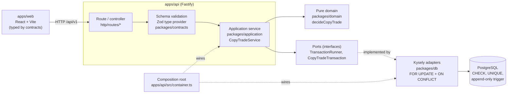

# Copy Trade

A social-trading "copy trade" backend and console: when a trader places a trade, each follower
copies it **exactly once**, only when eligible, and **never overdraws** — even with duplicate
deliveries, concurrent requests and several API instances sharing one PostgreSQL database.

```
Trade    { id, traderId, amount }                       amounts are integer minor units
Follower { id, balance, remainingAllocation, copyingEnabled }
processCopyTrade(trade, follower) -> copied | duplicate | rejected(reason)
```

## Quick start (only Docker required)

```bash
cp .env.example .env            # optional: every value has a default
docker compose up --build --wait
open http://localhost:8080      # UI      (API: http://localhost:3000, OpenAPI: /docs)
```

`docker compose up` starts Postgres, runs the migrations (one-shot `migrate` service), starts
the API once migrations succeed and serves the UI (nginx, proxies `/api` to the API) once the
API is healthy. Every service has a health check. Stop with `docker compose down` (`-v` to wipe data).

In the UI the four scenario buttons each create a fresh follower and fire the requests:

| Button                        | Follower       | Requests                           | Expected                                             |
| ----------------------------- | -------------- | ---------------------------------- | ---------------------------------------------------- |
| Normal copy                   | 10,000 / 2,000 | one 700 trade                      | `201 copied`, 9,300 / 1,300                          |
| Same trade twice (sequential) | 10,000 / 2,000 | same trade id, one after the other | `201` + `200 duplicate`, debited once                |
| Same trade twice (concurrent) | 10,000 / 2,000 | same trade id, in parallel         | one `copied`, one `duplicate`                        |
| Two concurrent 700 trades     | 1,000 / 1,000  | two different trades, in parallel  | one `201`, one `422 INSUFFICIENT_BALANCE`, 300 / 300 |

The forms below cover the rejection cases (copying disabled, insufficient balance or
allocation, invalid amount, self-copy: use the follower id as trader id). Trade ids starting
with `fail-` are rejected by the simulated broker, which shows compensation (status `failed`,
refund). "Run reconciliation" verifies the ledger.

## Architecture



```
copy-trade/
├── apps/
│   ├── api/            Fastify app: config (validated env), composition root, routes, observability,
│   │                   outbox relay + reconciliation loops, jobs (migrate, reconcile), Dockerfile
│   └── web/            Vite + React console, nginx Dockerfile
├── packages/
│   ├── domain/         pure rules: eligibility, refund, ledger status transitions, reconciliation math
│   ├── application/    use cases + ports (repository interfaces), retry policy; testing/ in-memory adapters
│   ├── contracts/      Zod schemas shared by API (validation/serialization) and web (typed client)
│   └── db/             Kysely schema types, migrations, Postgres adapters implementing the ports
├── e2e/                Playwright (scenarios + recorded demo) against the compose stack
├── docker-compose.yml  postgres -> migrate -> api -> web
└── .github/workflows/ci.yml
```

Dependencies point inwards: `domain` depends on nothing; `application` on `domain`; `db`
implements `application` ports; only `apps/api/src/container.ts` knows concrete classes.
Clock, id generator, sleep and jitter are injected, so every unit test is deterministic.

### One copy, step by step

`POST /v1/copy-trades` → Zod validates body and optional `Idempotency-Key` header →
`CopyTradeService.processCopyTrade` runs **one transaction**:

1. `SELECT … FROM followers WHERE id = $1 FOR UPDATE` (serializes copies per follower across
   connections, processes and hosts)
2. duplicate check by `(trade_id, follower_id)` (and by idempotency key) → `duplicate`, original record
3. `decideCopyTrade(trade, follower)` (pure) → `rejected(reason)` or the debited follower
4. `UPDATE followers SET balance, remaining_allocation`
5. `INSERT INTO follower_trades … ON CONFLICT DO NOTHING RETURNING *` (no row → roll back and retry → `duplicate`)
6. `INSERT INTO outbox` (downstream execution, same transaction)
7. `COMMIT`

Deadlocks (`40P01`) and serialization failures (`40001`) are retried with bounded exponential
backoff and full jitter (`TX_MAX_ATTEMPTS`). `CHECK (balance >= 0)`, `CHECK (remaining_allocation >= 0)`,
`CHECK (amount > 0)` and the unique constraints are the last line of defence.

### Ledger, outbox and reconciliation

- `follower_trades` is an **append-only ledger** (trigger rejects `DELETE` and changes to any
  column except `status`; only `pending → executed | failed`).
- Followers store `opening_balance` / `opening_allocation`, so reconciliation can prove
  `balance = opening − Σ amount(pending, executed)` (allocation likewise), one row per key, never negative.
- The **outbox relay** (`ExecutionService`, `FOR UPDATE SKIP LOCKED`, safe with many instances)
  executes entries via an idempotent gateway; after `OUTBOX_MAX_ATTEMPTS` failures it marks the
  entry `failed` and refunds in the same transaction (the conditional `pending → failed` update
  makes compensation idempotent).
- **Reconciliation** (`GET /v1/reconciliation`, periodic loop, and `pnpm reconcile` job which exits 1 on
  drift) only **reports**: Prometheus gauges + error logs. It never auto-fixes. `POST /v1/reconciliation/redrive`
  (or `pnpm reconcile --redrive`) explicitly re-queues stuck pending executions.

## API

| Method  | Path                                                             | Notes                                                                                                                                                                                                                               |
| ------- | ---------------------------------------------------------------- | ----------------------------------------------------------------------------------------------------------------------------------------------------------------------------------------------------------------------------------- |
| `POST`  | `/v1/followers`                                                  | `{ balance, allocation, copyingEnabled? }` → 201                                                                                                                                                                                    |
| `GET`   | `/v1/followers`, `/v1/followers/:id`, `/v1/followers/:id/trades` |                                                                                                                                                                                                                                     |
| `PATCH` | `/v1/followers/:id`                                              | `{ copyingEnabled }`                                                                                                                                                                                                                |
| `POST`  | `/v1/copy-trades`                                                | `{ trade: { id, traderId, amount }, followerId }`, optional `Idempotency-Key` header. 201 copied, 200 duplicate (same shape, original record), 404 unknown follower, 422 rejected, 409 key reused for another trade, 400 validation |
| `GET`   | `/v1/reconciliation`                                             | ledger verification report                                                                                                                                                                                                          |
| `POST`  | `/v1/reconciliation/redrive`                                     | re-queue stuck pending executions                                                                                                                                                                                                   |
| `GET`   | `/health/live`, `/health/ready`                                  | readiness checks the database                                                                                                                                                                                                       |
| `GET`   | `/metrics`                                                       | Prometheus                                                                                                                                                                                                                          |
| `GET`   | `/docs`                                                          | OpenAPI UI generated from the Zod schemas                                                                                                                                                                                           |

## Observability

- **Logs**: pino (structured JSON) through Fastify, `requestId` on every line; `x-request-id` is
  accepted and echoed (nginx injects one). Health probes are not logged.
- **Metrics** (`/metrics`, per-instance label): `http_request_duration_seconds`,
  `copy_trade_outcomes_total{outcome,reason}`, `copy_trade_transaction_retries_total`,
  `copy_trade_executions_total`, `reconciliation_drifted_followers`,
  `reconciliation_absolute_drift_minor_units`, `reconciliation_duplicate_keys`,
  `reconciliation_stuck_pending`, `reconciliation_last_run_timestamp_seconds`, Node defaults.
- **Tracing**: set `OTEL_EXPORTER_OTLP_ENDPOINT`; `dist/instrumentation.mjs` (loaded with
  `--import`) starts the OpenTelemetry SDK with HTTP and pg instrumentation plus a manual
  `copy_trade.process` span (no-op when unset).

## Development

Requirements: Node 22.12+, pnpm 10 (`corepack enable`), Docker.

```bash
pnpm install
cp .env.example .env
docker compose up -d postgres && pnpm db:migrate
pnpm dev                       # API on :3000 (tsx watch) + Vite on :5173 (proxies /api)
```

| Command                           | What it runs                                                                                              |
| --------------------------------- | --------------------------------------------------------------------------------------------------------- |
| `pnpm lint`                       | ESLint, `typescript-eslint` strict + stylistic type-checked, React hooks                                  |
| `pnpm format:check`               | Prettier                                                                                                  |
| `pnpm typecheck`                  | `tsc` per package (strict, `noUncheckedIndexedAccess`, `exactOptionalPropertyTypes`, …)                   |
| `pnpm test:unit`                  | Vitest: domain, services (in-memory adapters), fast-check properties, HTTP via `inject`                   |
| `pnpm test:coverage`              | unit + v8 coverage; thresholds 100% on `domain` and `application`                                         |
| `pnpm test:integration`           | Testcontainers Postgres: concurrency, constraints, deadlock retry, outbox, reconciliation, 3-process test |
| `pnpm test:mutation`              | Stryker on domain + application (break threshold 90%)                                                     |
| `pnpm stack:up` / `pnpm test:e2e` | compose stack, then Playwright against http://127.0.0.1:8080                                              |
| `pnpm demo:record`                | Playwright video walkthrough of the three scenarios                                                       |
| `pnpm reconcile [--redrive]`      | one-shot reconciliation job (exit 1 on drift)                                                             |
| `pnpm check`                      | everything above in CI order                                                                              |

Configuration is validated at startup by `apps/api/src/config.ts` (Zod). See `.env.example`
for every variable and its default.

## Verification results (latest run)

| Suite                                    | Result                                                                                       |
| ---------------------------------------- | -------------------------------------------------------------------------------------------- |
| Unit + property (Vitest, fast-check)     | 125 tests passed                                                                             |
| Coverage                                 | 100% statements / lines / functions, 97.56% branches overall; 100% on domain and application |
| Integration (Testcontainers Postgres 17) | 39 tests passed, incl. 3-process test and negative controls                                  |
| Mutation (Stryker)                       | 99.64% (273 killed, 3 timeout, 1 equivalent survivor)                                        |
| E2E (Playwright vs compose stack)        | 10 tests passed                                                                              |

### Note for some Linux VMs

If containers cannot reach each other (API cannot connect to `postgres`), the host's legacy
iptables `FORWARD` policy may be `DROP`. Allow bridge traffic:
`sudo iptables-legacy -I FORWARD 1 -i br+ -j ACCEPT && sudo iptables-legacy -I FORWARD 1 -o br+ -j ACCEPT`.
