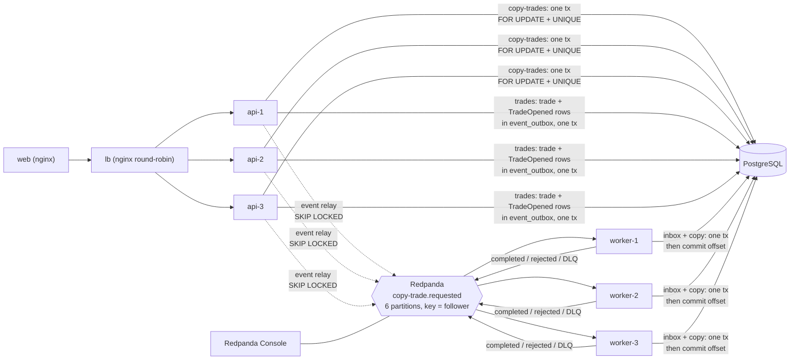
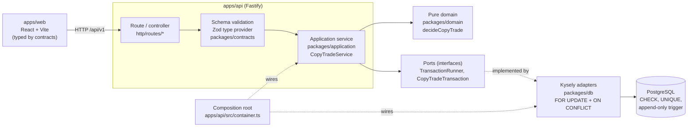

# Copy Trade

A social-trading "copy trade" backend and console: when a trader places a trade, each follower
copies it **exactly once**, only when eligible, and **never overdraws** — even with duplicate
deliveries, concurrent requests, several API replicas behind a load balancer and a group of
Kafka-compatible (Redpanda) consumers, all sharing one PostgreSQL database.

```
Trade    { id, traderId, amount }                       amounts are integer minor units
Follower { id, balance, remainingAllocation, copyingEnabled }
processCopyTrade(trade, follower) -> copied | duplicate | rejected(reason)
```

## Quick start (only Docker required)

```bash
cp .env.example .env            # optional: every value has a default
docker compose up --build --wait
open http://localhost:8080      # UI
open http://localhost:8090      # Redpanda Console (topics, partitions, messages, consumer group lag)
curl -i http://localhost:3000/health/ready   # API through the load balancer: see x-instance-id
pnpm install && pnpm load       # load test + invariant and reconciliation checks
```

| Service    | Replicas                      | Role                                                                          |
| ---------- | ----------------------------- | ----------------------------------------------------------------------------- |
| `postgres` | 1                             | the single source of truth (row locks, unique keys, CHECKs, ledger trigger)   |
| `redpanda` | 1                             | Kafka-compatible broker (dev-container mode), host listener `localhost:19092` |
| `console`  | 1                             | Redpanda Console on `:8090`                                                   |
| `migrate`  | one-shot                      | applies the Kysely migrations, then exits                                     |
| `api`      | `API_REPLICAS` (default 3)    | Fastify API; no host port, only reachable through `lb`                        |
| `lb`       | 1                             | nginx round-robin over every `api` replica (Docker DNS `resolve`), `:3000`    |
| `worker`   | `WORKER_REPLICAS` (default 3) | consumer group `copy-trade-workers`; metrics/health on `:9100` per container  |
| `web`      | 1                             | the UI (nginx), proxies `/api` to `lb`, `:8080`                               |

Every service has a health check; `--wait` returns when all are healthy. Scale at runtime with
`docker compose up -d --scale api=5 --scale worker=4` (nginx picks new replicas up without a
reload; the consumer group rebalances). Every API response carries `x-instance-id` (`api-1`,
`api-2`, …) and every ledger row records `handled_by` (the API replica or the worker that
copied it). Stop with `docker compose down` (`-v` to wipe data).

In the UI the four scenario buttons each create a fresh follower and fire the requests:

| Button                        | Follower       | Requests                           | Expected                                             |
| ----------------------------- | -------------- | ---------------------------------- | ---------------------------------------------------- |
| Normal copy                   | 10,000 / 2,000 | one 700 trade                      | `201 copied`, 9,300 / 1,300                          |
| Same trade twice (sequential) | 10,000 / 2,000 | same trade id, one after the other | `201` + `200 duplicate`, debited once                |
| Same trade twice (concurrent) | 10,000 / 2,000 | same trade id, in parallel         | one `copied`, one `duplicate`                        |
| Two concurrent 700 trades     | 1,000 / 1,000  | two different trades, in parallel  | one `201`, one `422 INSUFFICIENT_BALANCE`, 300 / 300 |

The forms below cover the rejection cases (copying disabled, insufficient balance or
allocation, invalid amount, self-copy: use the follower id as trader id). Trade ids starting
with `fail-` are rejected by the simulated broker, which shows compensation (status `failed`,
refund). "Run reconciliation" verifies the ledger. The header shows which replica served the
last response; the scenario table shows the replica of every request, the trades table the
replica or worker that recorded each copy.

Three more panels:

- **Multiple API replicas** fires 12 concurrent requests through the load balancer: the same
  trade six times for one follower (10,000 / 2,000) and two different 700 trades for each of
  three followers on 1,000 / 1,000. It shows the replica that served each request ("Replicas used
  3/3"), the final state (9,300 / 1,300 and 300 / 300, one copy each), the recorded trades with
  `handled_by`, and a clean reconciliation.
- **Event bus** opens trades with `POST /v1/trades` for a trader with five subscribers (one with
  copying off) and one non-subscriber: a 200 trade (then the same trade again, sequentially and
  twice concurrently: `200 duplicate`), two concurrent 700 trades, a conflicting resubmission
  (`409`), and finally a forced redelivery of every event. It shows, per follower trade, the
  outcome, the worker, and the partition and offset; then the final state, "ledger rows 9 → 9"
  after the redelivery, and reconciliation. Links open Redpanda Console on the topics and the
  consumer group (lag).
- **Instances** lists live API replicas and workers (heartbeats in Postgres) and each worker's
  assigned partitions; kill a worker (`docker kill copy-trade-worker-2`) and watch it turn
  `lost` and its partitions move to the survivors.

## Architecture



Layers inside each app:



```
copy-trade/
├── apps/
│   ├── api/            Fastify app: config (validated env), composition root, routes, observability,
│   │                   execution outbox relay, event relay (outbox -> Kafka), heartbeats,
│   │                   reconciliation loop, jobs (migrate, reconcile), Dockerfile
│   ├── worker/         Kafka consumer-group member: handler (retry -> DLQ), consumer (manual offset
│   │                   commits, rebalance tracking, lag), metrics/health server, Dockerfile
│   └── web/            Vite + React console, nginx Dockerfile
├── packages/
│   ├── domain/         pure rules: eligibility, refund, ledger status transitions, reconciliation math
│   ├── application/    use cases + ports (repository interfaces), retry policy; testing/ in-memory adapters
│   ├── contracts/      Zod schemas shared by API, worker and web: HTTP DTOs, event contracts, topics
│   ├── db/             Kysely schema types, migrations, Postgres adapters implementing the ports
│   ├── messaging/      kafkajs client/producer factories, topic provisioning, event codec, publishers
│   └── platform/       shared runtime helpers: logger, instance id, periodic tasks, system clock/ids
├── deploy/lb/          nginx load-balancer config for the API replicas
├── scripts/load.ts     autocannon load test + invariant checks (`pnpm load`)
├── e2e/                Playwright (scenarios, multi-replica, event bus, recorded demo)
├── docker-compose.yml  postgres, redpanda, console, migrate, api ×3, lb, worker ×3, web
└── .github/workflows/ci.yml
```

Dependencies point inwards: `domain` depends on nothing; `application` on `domain`; `db` and
`messaging` implement `application` ports; only `apps/api/src/container.ts` and
`apps/worker/src/main.ts` know concrete classes.
Clock, id generator, sleep and jitter are injected, so every unit test is deterministic.

### One copy, step by step

`POST /v1/copy-trades` → Zod validates body and optional `Idempotency-Key` header →
`CopyTradeService.processCopyTrade` runs **one transaction**:

1. `SELECT … FROM followers WHERE id = $1 FOR UPDATE` (serializes copies per follower across
   connections, processes and hosts)
2. duplicate check by `(trade_id, follower_id)` (and by idempotency key) → `duplicate`, original record
3. `decideCopyTrade(trade, follower)` (pure) → `rejected(reason)` or the debited follower
4. `UPDATE followers SET balance, remaining_allocation`
5. `INSERT INTO follower_trades … ON CONFLICT DO NOTHING RETURNING *` (no row → roll back and retry → `duplicate`)
6. `INSERT INTO outbox` (downstream execution, same transaction)
7. `COMMIT`

Deadlocks (`40P01`) and serialization failures (`40001`) are retried with bounded exponential
backoff and full jitter (`TX_MAX_ATTEMPTS`). `CHECK (balance >= 0)`, `CHECK (remaining_allocation >= 0)`,
`CHECK (amount > 0)` and the unique constraints are the last line of defence.

### Ledger, outbox and reconciliation

- `follower_trades` is an **append-only ledger** (trigger rejects `DELETE` and changes to any
  column except `status`; only `pending → executed | failed`).
- Followers store `opening_balance` / `opening_allocation`, so reconciliation can prove
  `balance = opening − Σ amount(pending, executed)` (allocation likewise), one row per key, never negative.
- The **outbox relay** (`ExecutionService`, `FOR UPDATE SKIP LOCKED`, safe with many instances)
  executes entries via an idempotent gateway; after `OUTBOX_MAX_ATTEMPTS` failures it marks the
  entry `failed` and refunds in the same transaction (the conditional `pending → failed` update
  makes compensation idempotent).
- **Reconciliation** (`GET /v1/reconciliation`, periodic loop, and `pnpm reconcile` job which exits 1 on
  drift) only **reports**: Prometheus gauges + error logs. It never auto-fixes. `POST /v1/reconciliation/redrive`
  (or `pnpm reconcile --redrive`) explicitly re-queues stuck pending executions.

### Event-driven path (Redpanda)

1. `POST /v1/trades` (`TradeService.openTrade`) runs **one transaction**: `INSERT INTO trades … ON
CONFLICT DO NOTHING` (a resubmission is `200 duplicate`; same id with a different trader or
   amount is `409 trade_conflict`), then one `TradeOpened` row per eligible follower
   (subscribed to the trader, copying enabled, not the trader itself) in `event_outbox`. `202`.
2. The **event relay** in every API replica (`EventRelayService`) claims due rows with
   `FOR UPDATE SKIP LOCKED`, publishes them with an idempotent producer (`acks=all`) to
   `copy-trade.requested` (6 partitions, **key = follower id**, so one follower's events stay
   ordered on one partition), then marks them published. A failed publish reschedules with
   backoff. Publishing is at-least-once: a crash between publish and mark re-sends the event.
3. Each **worker** (`apps/worker`, N replicas, consumer group `copy-trade-workers`) handles a
   message in one Postgres transaction (`CopyTradeService.processRequestedEvent`): lock the
   follower `FOR UPDATE` → look the `event_id` up in the `processed_events` **inbox** (seen →
   `redelivered`, return the stored outcome, no effect) → the same copy logic as the HTTP path
   (duplicate check on `(trade_id, follower_id)`, pure decision, debit, ledger insert with
   `handled_by = worker-n`) → insert the inbox row → `COMMIT`. Only then is the result
   published to `copy-trade.completed` / `copy-trade.rejected` (event id `<event>:result`,
   header `causation-id`) and **the offset committed**. A crash anywhere before the commit
   redelivers the message, and the inbox makes the redelivery harmless.
4. Failures are retried in the worker (`WORKER_MAX_ATTEMPTS`, linear backoff). Malformed
   messages (schema validation) and messages that still fail go to `copy-trade.requested.dlq`
   with `dlq-reason`, `dlq-error`, `dlq-attempts` and `dlq-source` (`topic/partition@offset`)
   headers; the offset is then committed so a poison message never blocks its partition.
5. **Rebalancing and shutdown**: `SIGTERM` stops consuming, waits for in-flight messages,
   commits, leaves the group (immediate rebalance), disconnects, marks the instance stopped.
   A `SIGKILL`ed worker is evicted after `KAFKA_SESSION_TIMEOUT_MS`; its uncommitted messages are
   redelivered to the new owner and recognised by the inbox.

`POST /v1/trades/:id/republish` re-enqueues every event of a trade with the **same event ids**
(a forced redelivery, used by the UI and the load test). Typed event contracts
(`TradeOpenedEventSchema`, `CopyTradeResultEventSchema`, `TOPICS`, `EVENT_HEADERS`) live in
`packages/contracts`; the codec in `packages/messaging` validates every message on the way in.

kafkajs 2.2.4 is used for its well-understood consumer-group semantics (manual commits,
`GROUP_JOIN` / `REBALANCING` / `CRASH` events) even though it is no longer actively maintained;
`@platformatic/kafka` or `@confluentinc/kafka-javascript` are the drop-in candidates behind the
same `packages/messaging` boundary.

## API

| Method  | Path                                                             | Notes                                                                                                                                                                                                                               |
| ------- | ---------------------------------------------------------------- | ----------------------------------------------------------------------------------------------------------------------------------------------------------------------------------------------------------------------------------- |
| `POST`  | `/v1/followers`                                                  | `{ balance, allocation, copyingEnabled? }` → 201                                                                                                                                                                                    |
| `GET`   | `/v1/followers`, `/v1/followers/:id`, `/v1/followers/:id/trades` |                                                                                                                                                                                                                                     |
| `PATCH` | `/v1/followers/:id`                                              | `{ copyingEnabled }`                                                                                                                                                                                                                |
| `POST`  | `/v1/copy-trades`                                                | `{ trade: { id, traderId, amount }, followerId }`, optional `Idempotency-Key` header. 201 copied, 200 duplicate (same shape, original record), 404 unknown follower, 422 rejected, 409 key reused for another trade, 400 validation |
| `POST`  | `/v1/trades`                                                     | `{ id, traderId, amount }`: 202 accepted (events enqueued for every eligible follower), 200 duplicate, 409 trade_conflict, 400 validation                                                                                           |
| `GET`   | `/v1/trades`, `/v1/trades/:id`                                   | trade with, per follower, event id, publish time and the processed outcome (worker, partition, offset)                                                                                                                              |
| `POST`  | `/v1/trades/:id/republish`                                       | forced redelivery of every event of the trade (same event ids)                                                                                                                                                                      |
| `GET`   | `/v1/instances`, `/v1/system`                                    | live API replicas / workers (heartbeats, partitions); event-bus info (topics, group, Console URL)                                                                                                                                   |
| `GET`   | `/v1/reconciliation`                                             | ledger verification report                                                                                                                                                                                                          |
| `POST`  | `/v1/reconciliation/redrive`                                     | re-queue stuck pending executions                                                                                                                                                                                                   |
| `GET`   | `/health/live`, `/health/ready`                                  | readiness checks the database                                                                                                                                                                                                       |
| `GET`   | `/metrics`                                                       | Prometheus                                                                                                                                                                                                                          |
| `GET`   | `/docs`                                                          | OpenAPI UI generated from the Zod schemas                                                                                                                                                                                           |

## Observability

- **Logs**: pino (structured JSON) through Fastify, `requestId` on every line; `x-request-id` is
  accepted and echoed (nginx injects one). Health probes are not logged.
- **Metrics** (`/metrics`, per-instance label): `http_request_duration_seconds`,
  `copy_trade_outcomes_total{outcome,reason}`, `copy_trade_transaction_retries_total`,
  `copy_trade_executions_total`, `reconciliation_drifted_followers`,
  `reconciliation_absolute_drift_minor_units`, `reconciliation_duplicate_keys`,
  `reconciliation_stuck_pending`, `reconciliation_last_run_timestamp_seconds`, Node defaults.
- **Worker metrics** (`:9100/metrics` in each worker container): `worker_messages_processed_total{outcome}`
  (`copied`, `duplicate`, `rejected`, `redelivered`), `worker_dead_letters_total{reason}`,
  `worker_processing_retries_total`, `worker_message_duration_seconds`,
  `kafka_consumer_lag{topic,partition}` and `kafka_consumer_lag_total` (high watermark minus the
  group's committed offset), `kafka_assigned_partitions`, `kafka_consumer_rebalances_total`.
  `/health/ready` is ready once the worker has joined the group.
- **Structured logs** in both apps carry `service` and `instanceId`; worker lines carry `eventId`,
  `tradeId`, `followerId`, `partition`, `offset` and an `event` name (`worker.processed`,
  `worker.dead_letter`, `kafka.group_join`, `kafka.rebalancing`, …).
- **Tracing**: set `OTEL_EXPORTER_OTLP_ENDPOINT`; `dist/instrumentation.mjs` (loaded with
  `--import`) starts the OpenTelemetry SDK with HTTP and pg instrumentation plus a manual
  `copy_trade.process` span (no-op when unset).

## Development

Requirements: Node 22.12+, pnpm 10 (`corepack enable`), Docker.

```bash
pnpm install
cp .env.example .env
docker compose up -d postgres && pnpm db:migrate
docker compose up -d redpanda   # optional: the event bus (KAFKA_BROKERS=127.0.0.1:19092)
pnpm dev                       # API on :3000, worker (metrics :9100), Vite on :5173 (proxies /api)
```

| Command                           | What it runs                                                                                                                                                                                                                             |
| --------------------------------- | ---------------------------------------------------------------------------------------------------------------------------------------------------------------------------------------------------------------------------------------- |
| `pnpm lint`                       | ESLint, `typescript-eslint` strict + stylistic type-checked, React hooks                                                                                                                                                                 |
| `pnpm format:check`               | Prettier                                                                                                                                                                                                                                 |
| `pnpm typecheck`                  | `tsc` per package (strict, `noUncheckedIndexedAccess`, `exactOptionalPropertyTypes`, …)                                                                                                                                                  |
| `pnpm test:unit`                  | Vitest: domain, services (in-memory adapters), fast-check properties, HTTP via `inject`                                                                                                                                                  |
| `pnpm test:coverage`              | unit + v8 coverage; thresholds 100% on `domain` and `application`                                                                                                                                                                        |
| `pnpm test:integration`           | Testcontainers Postgres + Redpanda: concurrency, constraints, deadlock retry, outboxes, reconciliation, 3-process API test, event bus (redelivery, duplicates, cross-worker 700/700, SIGKILL mid-run, DLQ, rebalance, negative controls) |
| `pnpm test:mutation`              | Stryker on domain + application + worker handler (break threshold 90%)                                                                                                                                                                   |
| `pnpm stack:up` / `pnpm test:e2e` | compose stack, then Playwright against http://127.0.0.1:8080                                                                                                                                                                             |
| `pnpm load`                       | autocannon through the load balancer (copy-trades, then trades through the worker group, then a redelivery storm) and invariant checks; `LOAD_KILL_WORKER=copy-trade-worker-2` kills a worker mid-drain                                  |
| `pnpm demo:record`                | Playwright video walkthrough of the three scenarios                                                                                                                                                                                      |
| `pnpm reconcile [--redrive]`      | one-shot reconciliation job (exit 1 on drift)                                                                                                                                                                                            |
| `pnpm check`                      | everything above in CI order                                                                                                                                                                                                             |

Configuration is validated at startup by `apps/api/src/config.ts` and `apps/worker/src/config.ts` (Zod). See `.env.example`
for every variable and its default.

## Verification results (latest run)

| Suite                                | Result                                                                                    |
| ------------------------------------ | ----------------------------------------------------------------------------------------- |
| Unit + property (Vitest, fast-check) | 185 tests passed (19 files)                                                               |
| Coverage                             | 99.6% statements, 95.96% branches, 99.32% functions, 99.78% lines                         |
| Integration (Testcontainers)         | 58 tests passed (Postgres 17 + Redpanda), incl. worker SIGKILL, DLQ and negative controls |
| Mutation (Stryker)                   | 99.77% (425 killed, 7 timeout, 1 equivalent survivor)                                     |
| E2E (Playwright vs compose stack)    | 13 tests passed                                                                           |
| Load (`pnpm load`)                   | All invariants hold and reconciliation is clean, also with a worker SIGKILLed mid-drain   |

### Note for some Linux VMs

If containers cannot reach each other (API cannot connect to `postgres`), the host's legacy
iptables `FORWARD` policy may be `DROP`. Allow bridge traffic:
`sudo iptables-legacy -I FORWARD 1 -i br+ -j ACCEPT && sudo iptables-legacy -I FORWARD 1 -o br+ -j ACCEPT`.
